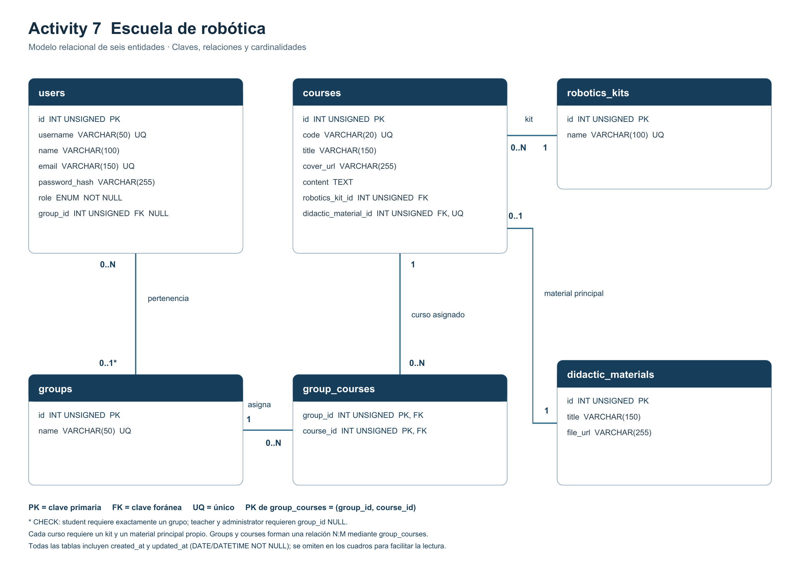

# Activity 7 Escuela de robótica

Proyecto independiente de PrintBox para modelar una escuela de robótica. Implementado con **Express + Sequelize + MySQL/MariaDB**, con la adaptación de framework autorizada por el docente. Sequelize sustituye a Eloquent y su CLI sustituye a Artisan para generar modelos y migraciones. No es un proyecto Laravel.

## Homework 6: población de datos

Se agregaron seeders de usuarios y kits y una factory con **@faker-js/faker 10.6.0**, equivalente para JavaScript de FakerPHP. Se conservan los cuatro cursos del caso y se crean **100 cursos adicionales**, claves `HW6-001` a `HW6-100`: **104 cursos en total**, cada uno con su material principal. Los títulos son cadenas de hasta 150 caracteres, la portada es una ruta local existente (hasta 255), el contenido es texto y las claves foráneas referencian kits reales.

| Username | Email | Rol almacenado |
| --- | --- | --- |
| Admon | admon@robotics.com | administrator (Administrative) |
| Tecmilenio | tecmilenio@robotics.com | teacher (Teacher) |
| Student | student@robotics.com | student (Student) |

Las tres cuentas académicas usan la contraseña solicitada `Adm@2022`, almacenada como **scrypt con sal aleatoria individual**. El estudiante pertenece a `beginner`. Se mantienen los cinco usuarios de ejemplo anteriores: ocho usuarios en total. Las cuentas anteriores reciben username `user_<id>` y un hash aleatorio sin contraseña conocida. No se implementa inicio de sesión; se comprueba el hash en las pruebas. Las consultas de usuarios, incluso dentro de relaciones, excluyen `password_hash`.

Los kits son `StarterKit`, `Educational Robotics Kit` y `Kit5`. Las semillas nuevas evitan duplicados por email/username, nombre del kit o código de curso. `SequelizeData` registra las ejecuciones. Deshacer la semilla de kits conserva los registros compartidos de Activity 7. Las semillas de usuarios y cursos son datos académicos: sus métodos `down` eliminan esos registros de prueba y no deben usarse sobre datos reales modificados.

### Actualizar una instalación de Activity 7

```powershell
npm ci
npm run db:migrate
npm run db:seed
```

La migración nueva agrega `username` y `password_hash` y conserva los datos existentes. Para una instalación limpia, seguir los pasos completos de instalación más abajo. Los cursos generados tienen una guía de práctica compartida como archivo, con un registro de material independiente por curso.

### Diagrama ER actualizado



### Validación de Homework 6

Ocho pruebas automatizadas aprobadas en una instalación limpia y en la restauración del SQL. También se verificó la actualización de la base existente de Activity 7, la reversión y nueva ejecución de las tres semillas, y la ejecución repetida sin duplicados.

| Resultado final | Cantidad |
| --- | --- |
| Usuarios originales + nuevos | 5 + 3 = 8 |
| Kits | 3 |
| Cursos originales + factory | 4 + 100 = 104 |
| Materiales didácticos | 104 |

### Referencias consultadas

- [FakerPHP: tipos y proveedores de datos](https://fakerphp.org/).
- [Faker para JavaScript: uso y requisitos](https://fakerjs.dev/guide/).
- [API Faker lorem](https://fakerjs.dev/api/lorem.html) y [helpers](https://fakerjs.dev/api/helpers.html).
- [Node.js: scrypt](https://nodejs.org/api/crypto.html#cryptoscryptpassword-salt-keylen-options-callback).
- [Sequelize: migraciones y seeders](https://sequelize.org/docs/v6/other-topics/migrations/).

## Entregables

- [Diagrama ER en PNG](docs/diagrama_er.png)
- [Diagrama ER en PDF](docs/diagrama_er.pdf)
- [Base de datos actualizada Homework 6](database/homework6.sql)
- [Exportación histórica Activity 7](database/activity7.sql)
- [Comandos usados para generar archivos](docs/CLI_GENERATION.md)
- [Diseño y validación](docs/DESIGN.md)

El [reporte editable de entrega y sus adjuntos](docs/REPORT.md) están enlazados en `docs/REPORT.md`.

## Modelo

Seis entidades y seis controladores de consulta:

| Tabla | Modelo | Controlador |
| --- | --- | --- |
| users | User | UserController |
| groups | Group | GroupController |
| courses | Course | CourseController |
| robotics_kits | RoboticsKit | RoboticsKitController |
| didactic_materials | DidacticMaterial | DidacticMaterialController |
| group_courses | GroupCourse | GroupCourseController |

- Un usuario tiene un solo rol: `student`, `teacher` o `administrator`.
- Un estudiante requiere un grupo. Los otros roles no tienen grupo. Una restricción CHECK protege esta regla también fuera del ORM.
- Los grupos son registros: inicialmente `beginner`, `intermediate` y `advanced`, y se pueden agregar más sin modificar el esquema.
- Grupos y cursos tienen relación N:M mediante la clave primaria compuesta de `group_courses`.
- Un kit puede usarse en varios cursos; cada curso requiere un kit.
- Se asume un material principal propio por curso: FK obligatoria y única en `courses`. El material puede existir antes de vincularse a su curso.

## Instalación en Windows PowerShell

Requisitos: Node.js 22.13 o superior (probado con Node.js 24.19) y MariaDB 10.4 o MySQL 8.0.16 o superior, para que CHECK se aplique.

```powershell
npm ci
Copy-Item .env.example .env
# Configurar usuario, contraseña, puerto y base en .env; encender MySQL/MariaDB.
npm run db:create
npm run db:migrate
npm run db:seed
npm run dev
```

No repetir `db:create` si la base ya existe. El seeder registra su ejecución en `SequelizeData`. La configuración por defecto usa `activity7`, puerto de BD 3306 y puerto web 3001. No incluir `.env` ni `node_modules` en Git.

## API de consulta

GET `/api/users`, `/api/groups`, `/api/courses`, `/api/robotics-kits`, `/api/didactic-materials` y `/api/group-courses`. Los primeros cinco recursos admiten `/:id`; las asignaciones usan `/:groupId/:courseId`. GET `/health` comprueba el servidor.

Los controladores incluyen las relaciones relevantes. La actividad cubre modelado, consultas y entregables; no implementa autenticación ni una plataforma web completa.

## Pruebas en una base separada

```powershell
$env:DB_NAME = 'activity7_test'
npm run db:create
npm run db:migrate
npm run db:seed
npm test
Remove-Item Env:DB_NAME
```

`npm test` exige un nombre de base `activity7..._test`. Verifica los datos del caso, asociaciones, integridad referencial, roles, unicidad, los seis controladores, las contraseñas, los 100 cursos y la repetición de semillas. Los registros temporales se revierten mediante una transacción.

## Importar la entrega SQL

En phpMyAdmin: crear una base vacía `activity7`, seleccionarla, abrir **Importar**, elegir `database/homework6.sql` y ejecutar. Importar el SQL es una alternativa a ejecutar migraciones y semillas: no hacer ambas inicializaciones sobre una base ya cargada.

La exportación incluye esquema, restricciones, datos de ejemplo y las tablas técnicas de historial de Sequelize. Se obtuvo con `mysqldump` y se verificó importándola en `activity7_homework6_restore_test`. Los usuarios y los recursos didácticos son ejemplos académicos, no datos personales reales.
